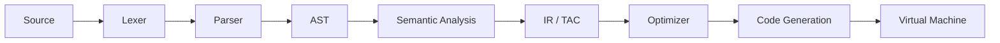

# Embedded C Subset Compiler

An educational compiler for a restricted C language: lexical analysis, parsing, semantic analysis,
optimization, code generation, and execution on a custom stack-based virtual machine, with a React frontend.

## Pipeline



## Team and modules

| Module | Scope | Owner | Docs |
|---|---|---|---|
| 1 | Lexical & syntax analysis (tokens, lexer, parser, AST) | Kotapati Sai Mounika | [docs/module1_lexer_parser.md](docs/module1_lexer_parser.md) |
| 2 | Semantic analysis, symbol table, IR, optimizer | _name_ | _coming soon_ |
| 3 | Code generation, VM, REST API, React frontend | _name_ | _coming soon_ |

## Build and test (backend)

```bash
cd backend
cmake -S . -B build -DENABLE_SANITIZERS=ON
cmake --build build
cd build && ctest --output-on-failure
```

## Documentation

- [Supported grammar and module interfaces](docs/grammar.md)
- [Module 1: lexer and parser](docs/module1_lexer_parser.md)