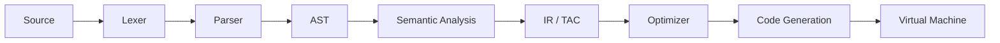

# Embedded C Subset Compiler

An educational compiler for a restricted C language: lexical analysis, parsing, semantic analysis,
optimization, code generation, and execution on a custom stack-based virtual machine, with a React frontend.

## Pipeline



## Team and modules

| Module | Scope | Owner | Docs |
|---|---|---|---|
| 1 | Lexical & syntax analysis (tokens, lexer, parser, AST) | Kotapati Sai Mounika | [docs/module1_lexer_parser.md](docs/module1_lexer_parser.md) |
| 2 | Semantic analysis, symbol table, IR, optimizer | Bailapudi Kusuma Teja | [docs/module2_semantic_ir_optimizer.md](docs/module2_semantic_ir_optimizer.md) |
| 3 | Code generation, VM, REST API, React frontend | Bodike Chaithali | [docs/module3_codegen_vm_api.md](docs/module3_codegen_vm_api.md) |

## Build and test (backend)

```bash
cd backend
cmake -S . -B build -DENABLE_SANITIZERS=ON
cmake --build build
cd build && ctest --output-on-failure
```

## Run the application

Terminal 1, the compiler API (from `backend/`):

```bash
./build/compiler_server            # http://127.0.0.1:8080
```

Terminal 2, the web UI (from `frontend/`, needs Node 18+):

```bash
npm install
npm run dev                        # http://localhost:5173
```

No browser? Compile and run a program straight from the command line:

```bash
./build/compiler_cli --ir --bytecode --trace program.c
```

## Documentation

- [Supported grammar and module interfaces](docs/grammar.md)
- [Module 1: lexer and parser](docs/module1_lexer_parser.md)
-  [Module 2: semantic analysis, symbol table, IR generation and optimization](docs/module2_semantic_ir_optimizer.md)
- [Module 3: code generation, VM, REST API and frontend](docs/module3_codegen_vm_api.md)
