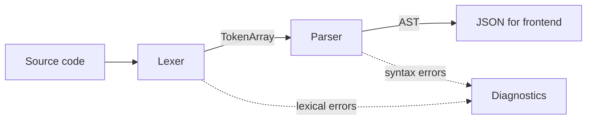

# Module 1 - Lexical & Syntax Analysis (Person 1: Kotapati Sai Mounika)

**Deliverable:** source code converted into a validated Abstract Syntax Tree (AST), with every error reported by line and column.

### Pipeline covered by this module



### What was implemented

| Component | File | Description |
|---|---|---|
| Tokens | `src/token.c`, `include/token.h` | Token types, `Token` struct, dynamic `TokenArray`, JSON output |
| Lexer | `src/lexer.c` | Character-by-character scanner. Keywords, identifiers, integer literals, all operators (including `<= >= == != && \|\|`), delimiters. Skips whitespace and `//` and `/* */` comments. Tracks line/column. |
| AST | `src/ast.c`, `include/ast.h` | Node types for program, declaration, assignment, binary/unary expression, integer, identifier, if, while, block. Traversal (`ast_walk`), text printer, JSON serializer, recursive cleanup. |
| Parser | `src/parser.c` | Recursive descent, one function per grammar rule. Correct precedence, left associativity, nested blocks/conditions/loops. |
| Diagnostics | `src/diagnostics.c` | Shared error/warning list used by every stage (stage, severity, message, line, column). |
| String buffer | `src/strbuf.c` | Safe growable buffer used to build JSON without fixed-size arrays. |
| Demo tool | `tools/frontend_demo.c` | Prints tokens, AST tree, or JSON for any source file. |

### Error handling

- **Lexical errors:** invalid characters (`@`, `$`), lone `&` / `|`, malformed numbers (`12abc`, `0x1F`, `007`), unterminated `/* ... `, unsupported operators (`++`, `+=`), preprocessor lines, string literals, non-ASCII characters.
- **Syntax errors:** `Expected expression after '='`, `Expected ';' after variable declaration`, `Expected ')' after condition`, `Unclosed '{'`, `'else' without a matching 'if'`, and more.
- **Unsupported constructs** (`for`, `break`, `return`, `float`, functions, function calls) give a clear "not supported in this C subset" message instead of being silently accepted.
- **Error recovery:** after a syntax error the parser skips to the next `;` or statement start and continues, so several mistakes are reported in one run. Invalid programs never produce an AST, so they cannot reach later stages.
- **Safety limits:** source size 64 KB, nesting depth 256, expression height 1000, at most 100 diagnostics per run.

### Example

Input:

```c
int x = 2;
while (x < 5) { x = x + 1; }
```

AST (from `frontend_demo`):

```text
Program
  Declaration 'int x'
    initializer: IntegerLiteral '2'
  WhileStatement
    condition: BinaryExpression '<'
      left: Identifier 'x'
      right: IntegerLiteral '5'
    body: Block
      Assignment 'x ='
        value: BinaryExpression '+'
          left: Identifier 'x'
          right: IntegerLiteral '1'
```

Error example (`int x = ;`):

```json
{"stage":"syntax","severity":"error","message":"Expected expression after '='","line":1,"column":9}
```

### Testing

- **968 unit checks** in `tests/lexer_tests.c` and `tests/parser_tests.c`: keywords, identifiers, literals, operators, comments, line/column positions, precedence, associativity, if / if-else, while, nested blocks, missing semicolons, invalid syntax, error recovery, JSON output, and limit handling.
- Built with `-Wall -Wextra -Wpedantic` in strict C11 mode with no warnings.
- Run under **AddressSanitizer and UndefinedBehaviorSanitizer**: no memory leaks or undefined behaviour.
- **Fuzzed** with 600,000 random token sequences and random byte inputs: no crashes, and every rejected program produced at least one diagnostic.

```bash
cd backend
cmake -S . -B build -DENABLE_SANITIZERS=ON
cmake --build build
cd build && ctest --output-on-failure

# try it
printf 'int x = 2;\nwhile (x < 5) { x = x + 1; }' | ./frontend_demo -
printf 'int x = ;' | ./frontend_demo --json -
```

### Design decisions

1. `int a = 1, b = 2;` becomes two `Declaration` nodes, one per variable.
2. A declaration cannot be the direct body of `if` / `while` (same as C); put it inside `{ }`.
3. Integer literals above 2147483647 are rejected by the parser, except `-2147483648`, so the semantic analyzer only ever sees valid 32-bit values.
4. Binary nodes carry the position of the operator, which gives precise locations for errors such as division by zero.
5. JSON is produced by a small built-in writer, so the lexer and parser have no external dependencies. The REST server can embed the strings directly.

The full grammar and the function-call interface for the other modules are in [`grammar.md`](grammar.md).