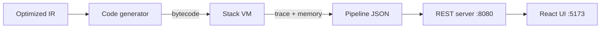

# Module 3 - Code Generation, Virtual Machine & Application (Person 3: Bodike Chaithali)

**Deliverable:** a working compiler application with execution and visualization. The optimized IR from
Module 2 is turned into bytecode, run on a custom stack VM, and exposed through a REST API and a React UI.



## What was implemented

| Component | File | Description |
|---|---|---|
| VM | `src/vm.c`, `include/vm.h` | Stack machine with 20 instructions, one memory slot per variable/temporary, single-step and run-to-end execution, runtime errors. |
| Code generator | `src/codegen.c`, `include/codegen.h` | Translates three-address IR to bytecode. Labels are resolved to addresses by back-patching; a `HALT` is appended. |
| Pipeline | `src/pipeline.c`, `include/pipeline.h` | Runs every stage (lexer to VM) on one source string and builds the JSON response, including the full execution trace. Shared by CLI and server. |
| CLI | `tools/compiler_cli.c` | Compile and run without a server: `--ir`, `--bytecode`, `--trace`, `--json`. |
| REST server | `src/server.c` | Dependency-free HTTP server (POSIX sockets / Winsock). |
| Frontend | `frontend/` | React + Vite UI: editor, pipeline status, token table, AST tree, IR before/after, bytecode, step-through VM viewer. |
| Tests | `tests/vm_tests.c`, `codegen_tests.c`, `pipeline_tests.c` | VM unit tests, IR-to-bytecode tests, end-to-end tests. |

## Instruction set

| Instruction | Effect |
|---|---|
| `PUSH n` | push constant `n` |
| `LOAD v` / `STORE v` | push the value of `v` / pop into `v` |
| `ADD SUB MUL DIV` | pop 2, push result |
| `LT GT LE GE EQ NE` | pop 2, push 0 or 1 |
| `AND OR` | pop 2, push 0 or 1 (both operands are evaluated, no short-circuit) |
| `NEG NOT` | pop 1, push result |
| `JMP a` | jump to address `a` |
| `JZ a` | pop; jump to `a` if the value is 0 |
| `HALT` | stop |

Example: `int x = 2; while (x < 5) { x = x + 1; }` compiles to

```
 0  PUSH 2       8  LOAD x
 1  STORE x      9  PUSH 1
 2  LOAD x      10  ADD
 3  PUSH 5      11  STORE t1
 4  LT          12  LOAD t1
 5  STORE t0    13  STORE x
 6  LOAD t0     14  JMP 2
 7  JZ 15       15  HALT
```
and finishes with `x = 5` after 48 steps. `JZ 15` leaves the loop when the condition is false, and `JMP 2` goes back to re-test it.

## Runtime rules

- All 32-bit signed integers; every slot starts at 0 (uninitialized variables read as 0).
- `+ - *` wrap around on overflow. `INT_MIN / -1` and division by zero are runtime errors.
- Execution stops with an error after 100,000 steps (infinite-loop protection).
- Stack size 256; stack underflow/overflow and a missing `HALT` are runtime errors.
- The JSON trace contains the first 2,000 steps; execution itself continues past that.

## Restrictions checked before code generation (stage `codegen`)

The IR has no scope information and names temporaries `t0, t1, ...`, so two things are rejected with a clear message:

- a variable named like a temporary (`t0`, `t1`, ...);
- a variable that re-uses the name of a variable in an enclosing block (shadowing).

## REST API

| Method and path | Description |
|---|---|
| `GET /api/health` | `{"status":"ok"}` |
| `POST /api/compile` | Body `{"source": "..."}`. Always returns `200` with the result below, even for compile errors. |

Response fields: `success`, `stage` (`ok`, `lexical`, `syntax`, `semantic`, `ir`, `optimizer`, `codegen` or `runtime`),
`tokens`, `ast`, `diagnostics`, `ir`, `optimizedIr`, `bytecode`, and `execution`
(`status`, `steps`, `error`, `traceTruncated`, `variables`, `finalMemory`, and `trace` entries with
`step`, `pc`, `nextPc`, `instruction`, `line`, `stack`, `memory`).
Malformed requests return `400/404/405/413` with `{"success":false,"stage":"request","error":"..."}`.
The server listens on `127.0.0.1:8080` by default (`--port`, `--host`) and sends CORS headers.

## Run and test

```bash
cd backend
cmake -S . -B build -DENABLE_SANITIZERS=ON && cmake --build build
cd build && ctest --output-on-failure        # 6 test programs
./compiler_cli --trace ../t.c                # run without the UI
./compiler_server                            # start the API

cd ../../frontend && npm install && npm run dev   # UI at http://localhost:5173
```

## Verification

- 6/6 CTest programs pass with AddressSanitizer and UBSan.
- 297 randomly generated programs gave the same final values as GCC.
- API checked with curl: success, syntax, runtime and infinite-loop cases, bad JSON, 404, 405, oversized body.
- UI checked against real compiler output for 10 example programs (6 valid, 4 error cases).